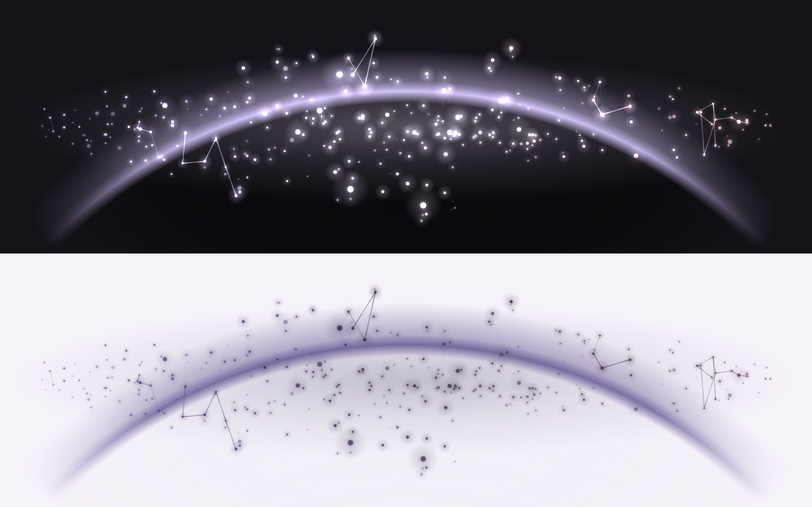

# Hyprwhspr Astral

An astral desktop voice visualizer for [hyprwhspr](https://github.com/goodroot/hyprwhspr), built
as a [DankMaterialShell](https://danklinux.com) **desktop widget**. It's a companion to
[Hyprwhspr Voice Overlay](https://github.com/lucianosrp/HyprwhsprVoiceOverlay) with a lighter,
more ephemeral look: a ribbon of twinkling stardust that breathes with your voice while
hyprwhspr records.



## What it does

- **Stardust ribbon**: a mirrored band of grains that lifts off a faint resting thread as you
  speak. It swells toward the middle and shimmers with organic, non-repeating motion.
- **Bright peaks**: quiet speech stays soft. Loud moments bloom, with larger grains,
  white-hot cores and a nebula band of light behind the ribbon. A sudden onset (a loud syllable
  after quiet) sets off a short flash and a burst of sparks.
- **Drifting motes**: at peaks, grains on the crest shed motes that drift away and fade. Motes
  keep the loudness they were born with, so loud syllables throw brighter, faster sparks.
- **Constellation links**: faint lines briefly join nearby stars, fade in, hold, and dissolve.
  They follow the stars as the ribbon moves and snap if stretched too far. At loud peaks they
  chain into 3–5 star constellations that light up in sequence.

Everything is driven by the single `audio_level` value hyprwhspr writes, so no FFT or audio
capture runs inside the shell.

## Behavior

- **Recording**: the scene animates, frame-synced and capped at the configured frame rate.
- **After recording stops**: a short exit animation plays (*Dissolve*, *Collapse*, *Fade* or
  *None*; 450 ms by default), then the frame loop stops completely.
- **Idle**: controlled by *When not recording*:
  - **Show dim placeholder** (default): a faint, static thread of stars painted once, so you
    can move and resize the widget without dictating.
  - **Hidden (overlay only)**: fully transparent until recording starts.

Like all DMS desktop widgets it lives on the background layer, visible on the desktop and
(with *Show on overview*) on the overview. It doesn't float above application windows.

## Data source

Same IPC as the other hyprwhspr widgets:
`$XDG_CONFIG_HOME/hyprwhspr/recording_status` (present while recording) and
`$XDG_CONFIG_HOME/hyprwhspr/audio_level` (live `0.000`–`1.000` mic level). The monitor loop uses
only shell builtins, so it forks no processes in steady state and goes silent while idle.

## Settings

Every visual parameter can be changed in the widget's settings:

| Section | Settings |
| --- | --- |
| Layout & visibility | Width, Height, When not recording, Exit animation, Exit duration, Idle opacity, Active opacity, Background panel |
| Response | Sensitivity, Auto gain, Voice reactivity, Ripple spread, Peak brightness, Onset sparkle |
| Stardust ribbon | Stars, Ribbon height, Star size, Twinkle, Motion speed, Nebula glow, Center swell |
| Drifting motes | Drift amount, Drift speed, Max motes |
| Constellation links | Connections (Off / Sparse / Woven / Dense), Link reach, Link lifetime, Constellations at peaks |
| Colors | Palette (Theme, Theme duo, Theme primary, Astral, Ember, Custom) + three custom colors |
| Performance | Glow quality (Full / Soft / Minimal), Frame rate cap |

The Theme palettes follow your DankMaterialShell colors and update when the wallpaper or theme
changes.

## Preview / tuning in a browser

`preview/index.html` loads the same `AstralEngine.js` as the widget, with a synthetic speech
signal, a live-mic mode and sliders for the settings above. Open it directly in a browser to try
looks before changing the widget.

## Install / use

```bash
git clone https://github.com/lucianosrp/HyprwhsprAstral ~/.config/DankMaterialShell/plugins/HyprwhsprAstral
dms restart   # desktop plugins are compiled at shell start
```

Add the widget from the DankMaterialShell desktop-widget controls (Settings → Widgets, or the
desktop widget picker), then drag or resize it and toggle *Show on overview* / *Click-through*
as desired.

## Implementation notes

- `AstralEngine.js` is plain ES2017 with no QML or DOM dependencies, and uses only Canvas 2D
  calls that behave the same in QML's `Canvas` and HTML `<canvas>`. Additive (`lighter`)
  blending makes overlapping grains glow.
- The QML side owns state, settings and the frame loop (`FrameAnimation`, dt-correct). The
  engine clamps dt, so a throttled or stalled frame never makes the scene jump.
- Measured cost in QML's JS engine at 760×260 with default settings: about 3.5 ms per frame
  (Minimal/Soft glow) to 4.5 ms (Full glow), only while animating.

## Requirements

- DankMaterialShell ≥ 1.2.0
- hyprwhspr

## License

MIT
